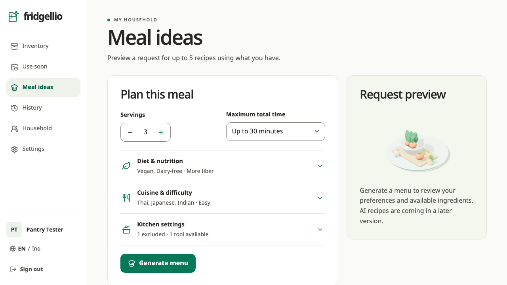
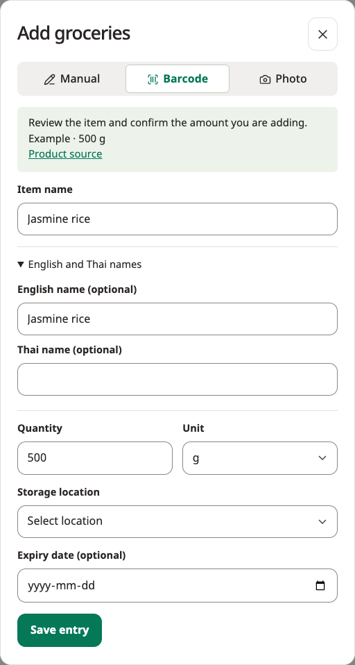

# Fridgellio

**What can I cook tonight with what I already have?** Fridgellio helps home cooks discover meals they want to make, use the ingredients that need attention first, and track what they actually cook or discard. We built Fridgellio from scratch at the Regional Codex Hackathon Thailand with Codex as our development assistant.



*Meal ideas lets you set preferences for a meal using what you have in the pantry.*

## Judging criteria

### Problem & Solution Fit

Opening a fridge full of food and still feeling unsure what to cook is a familiar problem across ages, households, and cooking skill levels. You might be tired of repeating the same dishes, unsure how to combine what you have, or worried that something will spoil before you get to it. Fridgellio uses your pantry, available time, equipment, and preferences to help you choose a meal you can make.

### Build Quality

The workflow is designed for beginners and experienced cooks. Add groceries by hand, from a photo, or by scanning a barcode, check **Use soon**, set your preferences, and review ingredient quantities and step-by-step cooking instructions. The app supports English and Thai. The backend checks stock quantities, units, and equipment before presenting generated recipes. In the demo, add an item, submit a meal request, then record a quantity used and verify the updated balance in **History**. The backend test suite covers expiry, unit compatibility, and household isolation.



*Review the product and confirm the quantity before adding it to the pantry.*

### Insight & Originality

**A recipe recommendation is an inventory decision.** Two recipes might match the same ingredients, yet one uses all 150 g of mushrooms due today while the other uses only 20 g. The proposed MVP ranks recipes using the quantity of urgent stock they can use, explains the ranking, and lets the cook explore small purchases within a budget. It distinguishes the cost of the portion used in the recipe from the cash needed to buy a full package. Recording actual use and discard then shows what happened after the recommendation.

### Real-World Value

Fridgellio helps people who are bored with their usual meals, people who have food at home and cannot decide what to make, and beginners who benefit from quantities and ordered cooking steps. A shared pantry and history help households see what is left and how much they use or throw away.

Our evaluation plan compares recommendations with basic ingredient matching on the same pantry data. We will measure how often people cook a suggested dish, how many grams of priority stock they use, and whether a small shopping option helps more people choose a recipe. Measuring actual waste reduction requires tracking discarded quantities against each household’s baseline month. We have yet to measure that outcome.

### Alignment with Build Direction

- **Autonomous & Adaptive AI.** When a cook points the camera at a barcode, Fridgellio reads it automatically and looks up the product. The cook reviews the details and confirms the quantity before adding it to the pantry. When the cook requests meal ideas, Fridgellio generates and checks recipes automatically. Each request uses the latest pantry quantities, use-by dates, and meal preferences. The cook confirms actual use or discard, and the resulting stock changes inform the next request. The planned ranking will use cooking and discard history to improve future suggestions.
- **AI-Native Products & Operations.** OpenAI adapts recipe suggestions to the live pantry, servings, time, equipment, and preferences for a particular meal. Home cooks can change those constraints and get a new set of ideas. The backend checks each generated recipe against available quantities and equipment before showing it.
- **Deep Domain AI.** A useful recipe depends on the form, quantity, and urgency of an ingredient. Canned tuna can go into a cooked rice bowl. A preparation that requires raw tuna needs a different ingredient. The project already checks stock and cooking constraints and includes ingredient-form guidance in its recipe prompts. The planned ranking extends that reasoning to use-by dates, available quantities, and what the household actually uses.

### Use of Codex

We used Codex across the project, from setting up the repository and building the FastAPI backend and Next.js frontend to implementing the pantry, barcode reading and product lookup, grocery photo analysis, and recipe recommendations and illustrations. Codex also helped write and run tests for barcode handling, recipe limits, bilingual display, and per-request preferences.

## Who it serves

The first release is designed for household members who shop and cook. They share one pantry where they can check what is already at home, see which groceries are due soon, and record what they used or discarded. Registration requires a first name and last name. Each member signs in to Fridgellio with their own username and password. Members can edit their names under **Settings → Profile**, where both fields are required. The top-bar profile button uses initials when a picture is unavailable, deriving them from the username for older accounts without saved names. Profile pictures are read-only.

## First-release experience

1. In **Add groceries**, enter items manually or select **Photo**. Choose **Open camera** to take a picture with your phone or webcam, or **Choose image** to select an existing photo. Preview the image and select **Analyze photo**. For a packaged product, select **Scan barcode** for automatic lookup or type the digits and select **Look up product**. Review the name, quantity, unit, and storage location before saving. Add an expiry date when available.
2. Open **Use soon** to see food dated within the next three days, with the closest dates first. Past-date entries appear in a separate list. Inventory shows a past-date alert, and the workspace top bar has an expiry-notification bell and profile menu on the right. Select **Review expired items** to open the past-date list.
3. In **Settings**, select a card for each piece of cooking equipment your household has. Select it again to remove it. Add any ingredients you want to exclude under **Foods to avoid**. In **Meal ideas**, choose servings and a time limit. Expand the sections for dietary styles, a nutrition goal, cuisines, difficulty, and kitchen settings. Adjust exclusions or equipment for this meal, then select **Generate menu** to see recommendations with AI-generated illustrations. Recipes are available while their images are generating.
4. Record what you used directly in inventory after cooking. Open **History** or an item's **Entry history** to see who added, used, or discarded stock and in what quantity. Open **Statistics** to compare actual use with groceries lost after expiry over the latest six months. Open **Household** to see who shares your pantry. The owner can create and remove unused invitation codes such as `K7RM-3X9D`.

Use the app in English or Thai. After joining a household, change language in **Settings → Language**; your profile remains in the top bar. Inventory uses a plain heading with a Three.js paper grocery bag that hops gently on hover or tap. Fridgellio saves both language versions of AI-generated grocery names and menus so switching languages can display the saved translation.

## Proposed MVP experience

1. **Stock the pantry.** Record each item’s name, quantity, unit, use-by date, and purchase price when available. **Use soon** brings the most urgent items to the top.
2. **Get three recipe recommendations.** The app uses available stock, servings, cooking time, equipment, and foods to avoid. Each card explains why the recipe was recommended, what it uses, the cost per serving, and whether anything needs to be purchased.
3. **Ask for other recipes.** Try a different meal from the same pantry, or set a shopping budget and a maximum number of items to buy. Compare recipes by the fewest additional items, the lowest checkout cost, or the best match for your preferences within budget.
4. **Record what happened.** Mark a recipe as cooked or an ingredient as discarded, then confirm the actual quantity before stock is updated. Link the recommendation to what the household cooked, used, or discarded, with an option to undo a mistaken entry.

### Example recipe card

**Spicy kimchi and mushroom noodles · 2 servings**

Uses all **150 g of mushrooms due today** and matches your preference for spicy noodles. Buy **one bag of kimchi for ฿35**.

| Cost | Calculation |
| --- | --- |
| **฿26 per serving** | Mushrooms ฿22.50 for 150 g of a ฿45, 300 g purchase, plus ฿12 for noodles and ฿17.50 for 100 g of kimchi from a ฿35, 200 g bag. The ฿52 recipe serves two. |
| **฿35 to spend** | The checkout cost of one full bag of kimchi. |

If a price needed for a total is missing, show **Price unknown** for that total.

## Implementation status

| Area | Status |
| --- | --- |
| Shared pantry and expiry tracking | Add groceries manually, from a photo, or by scanning a barcode. **Use soon** sorts groceries by expiry, and **History** shows quantities used or discarded. |
| Recipe recommendations and costs | Generate up to five bilingual recipes from eligible pantry stock and meal preferences. Recipes include AI-generated illustrations and use saved grocery prices for proportional cost estimates. |
| Food-waste ranking | The proposed MVP ranks up to three recipes and explains which ingredients nearing their use-by dates each recipe would use. |
| Budgeted shopping and outcomes | Planned work includes package-based shopping budgets, per-serving costs for recipes with planned purchases, linking recipes to actual use or waste, and undoing mistaken records. |

After the MVP, the roadmap includes monthly waste reports, rewards based on improvements against a household’s own baseline, receipt and whole-fridge photo scanning, and reminders outside the app for ingredients that should be used soon.

## Hackathon submission and declarations

- **Repository** [Fridgellio on GitHub](https://github.com/varachit/fridgellio)
- **Project write-up** This README covers the problem, solution, build directions, judging criteria, and use of Codex.
- **Demo** The setup steps below run the project locally. The submission form still needs a live demo or prototype link.
- **Built from scratch** The team created the Fridgellio application at the Regional Codex Hackathon Thailand with Codex’s help. No existing personal application served as the starting point. The application uses open-source dependencies and assets, including FastAPI, Next.js, ZXing-C++, and Lucide-derived icons.

Submit once per team via Google Form by **5:00 p.m. ICT on November 21, 2026**, using a new public repository. The demo and pitch have **6 minutes**, followed by **2 minutes** of Q&A in the first round or **4 minutes** in the final.

## Monorepo structure

| Path | Purpose |
| --- | --- |
| `docs/requirements.md` | First-release scope, business rules, and acceptance criteria |
| `docs/backend-stack.md` | Backend libraries, API documentation, and tooling |
| `docs/backend-todo.md` | Backend routes, implementation checklist, and verification status |
| `frontend/` | English and Thai Next.js application with NextAuth, TanStack Query, and Zustand, managed with `pnpm` |
| `backend/` | FastAPI service managed with `uv`, including PostgreSQL persistence, account and session management, barcode lookup, and Swagger UI |
| `assets/brand/` | Lucide-derived SVG logo variants and usage guidance |
| `frontend/experimental/` | Standalone Three.js illustration and Framer Motion UI preview, with exported GLB models |

FastAPI stores shared inventory, optional grocery prices in Thai baht, cooking equipment, and each member's private settings in PostgreSQL. Recipe recommendations use saved prices to show proportional cost estimates with coverage labels. Grocery photos are analyzed with OpenAI to produce editable bilingual item suggestions. Barcode lookup checks verified corrections by exact barcode, then uses OpenAI web search when configured, with Open Food Facts as a fallback. OpenAI also generates up to five bilingual recipe recommendations when configured. See the [backend stack](docs/backend-stack.md) for integration and Swagger details.

**Scan barcode** sends camera stills one at a time to `POST /api/barcodes/decode` as multipart `photo` fields. Once the endpoint returns barcode digits such as `"8851234567898"`, the camera stops and the frontend sends those digits to `GET /api/barcodes/{code}`.

## Run the backend

Copy [`.env.example`](.env.example) to `.env` at the repository root and set `DATABASE_URL` for the local `fridgellio` PostgreSQL database. Restrict deployed Swagger to developers or set `DOCS_ENABLED=false`.

```sh
cd backend
uv sync
uv run alembic upgrade head
uv run uvicorn fridgellio.main:create_app --factory --reload --no-access-log
```

Open Swagger UI at `http://127.0.0.1:8000/docs`. Register with `POST /api/auth/register` and supply `username`, `password`, `first_name`, and `last_name`. Sign in to an existing account with `POST /api/auth/login`. Copy the returned `token` into Swagger’s **Authorize** field to call protected routes. The household owner can issue single-use invites that expire after 24 hours and revoke them before use. Send one JPEG, PNG, or WebP file in the `photo` field to `POST /api/photos/analyze` for editable grocery suggestions. Use `POST /api/menus/recommendations` with `generate: true` to request recipe recommendations. Set `OPENAI_API_KEY` and restart the backend to enable both AI workflows.

See [Authentication operations](docs/backend-stack.md#authentication-operations) for password resets, expired session cleanup, and provisioning local credentials for existing accounts.

From `backend/`, run `uv run ruff check .`, `uv run ruff format --check .`, and `uv run pytest`. Set `FRIDGELLIO_TEST_DATABASE_URL` to also run the PostgreSQL tests. The test role needs permission to create a temporary schema.

For a Vercel API deployment, set the project's **Root Directory** to `backend` and **Framework Preset** to **FastAPI**. Vercel reads the application entrypoint from [backend/pyproject.toml](backend/pyproject.toml). After deployment, `GET /health/live` should return `{"status":"ok"}`.

### Try the OpenAI Responses API

Set `OPENAI_API_KEY` in the repository root `.env` using a key from your OpenAI project. Restart the backend after changing the key. [OpenAI API keys](https://platform.openai.com/api-keys)

Run the following command from `backend/` to make a test request.

```sh
uv run --locked --env-file ../.env python - <<'PY'
from openai import OpenAI

with OpenAI() as client:
    response = client.responses.create(
        model="gpt-5.4-mini",
        input="Reply with OK.",
        store=False,
    )
    print(response.output_text)
PY
```

## Run the frontend

Start the backend first, then open a second terminal with Node.js 22.18 or later and pnpm 10. On a new checkout, copy the frontend environment example to `frontend/.env.local` and set `NEXTAUTH_SECRET` to the output of `openssl rand -base64 32`. [Frontend environment example](frontend/.env.example)

```sh
cd frontend
pnpm install --frozen-lockfile
pnpm dev
```

Open `http://localhost:3000`, create an account, and create a household or join with an invitation code. The Next.js server connects to FastAPI at `http://127.0.0.1:8000` by default. See the [frontend guide](frontend/README.md) for configuration and browser tests.

## Project documentation

See [Product requirements](docs/requirements.md) for detailed behavior and acceptance criteria.

See [Design tokens and UX proposal](docs/design-tokens.md) for the proposed green-and-white visual system, Lucide icons, accessibility targets, and low-effort pantry workflows. Proposed features beyond the current first release are marked in that document.

The public landing page, sign-in and registration forms, and inventory header reuse the refrigerator and vegetable bowl from the [Three.js illustration study](frontend/experimental/README.md). Signed-out visitors can register or sign in from the landing page. Signed-in members open their household kitchen directly. Install its pinned dependencies with `npm ci --prefix frontend/experimental`, serve the repository with `python3 -m http.server 8765 --bind 127.0.0.1`, and open `http://127.0.0.1:8765/frontend/experimental/`. This standalone preview runs independently of the application and backend.
