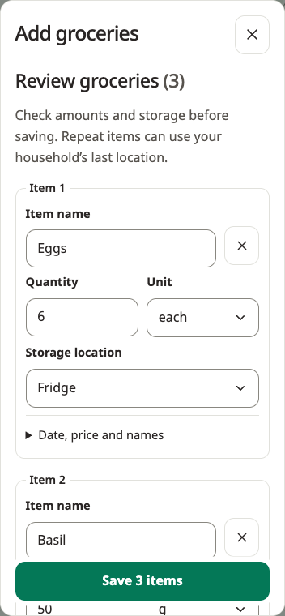

# Grocery entry and household adoption

The decision to measure is whether a household comes back after its next shop and enters groceries voluntarily. Fridgellio now lets a shopper scan a receipt, paste their list or photograph several groceries, confirm a basket once, and immediately check what expires soon or find a meal. A household can start with just the food it wants help using.

## Why start with lists and photos

| Evidence | Design decision |
| --- | --- |
| A Greek survey of 340 people found that 55.9% of respondents who did not use an app cited paper lists. Some doubted the benefit or felt an app would take too much time. Inventory and expiration information ranked highly. [FoodSaveShare study](https://www.mdpi.com/2071-1050/16/7/2800) | Accept a list someone already has in Notes or chat. For shoppers with a paper list or no list, let them photograph the groceries they actually brought home. Give them a concrete reason to open the pantry after saving. |
| All 24 participants in a randomized crossover study preferred photo-based logging and rated it less time-consuming than diaries during staged food-waste tasks. The tasks differed from entering purchases. [FoodImage trial](https://doi.org/10.1016/j.resconrec.2020.104858) | Test one group photo against the existing one-item form on the same basket. Include the time spent arranging items, waiting for analysis, correcting suggestions, and confirming storage. |
| Human–AI interaction research identifies quick correction, dismissal, and learning from past actions as design principles. [Microsoft Research guidelines](https://www.microsoft.com/en-us/research/wp-content/uploads/2019/01/AI-Guidelines-poster_PrintQuality.pdf) | Keep amounts editable, surface suggested dates, let shoppers remove or add rows, and suggest a storage location they previously confirmed. Ask for explicit confirmation before inventory changes. |

## What a shopper can do today

1. Open **Add groceries → Paste list**. Paste up to 40 lines. For example, `Eggs 6 each`, `1 kg rice`, and `ไข่ 3 ฟอง` each produce a row with the listed amount. A line like `Basil` or `Milk 2 cartons` stays editable with an empty amount and unit. This path works without an AI account or model call. The shopper removes planned items they did not buy.
2. Alternatively, open **Photo** and photograph the groceries while unpacking. One photo can suggest up to ten distinct items. When more items arrive, use another photo, add missed rows, or paste the longer list. Barcode and manual entry remain available for individual products.
3. For a paper receipt, open **Receipt**, include the item lines and currency in the image, then select **Read receipt**. The app reads up to 40 eligible lines per image. Compare abbreviations with **View original receipt**, correct amounts and THB line totals, and remove anything you do not want to track.
4. Review the basket. Shared storage fills only rows that still need a location. On repeat purchases the app looks up the most recent matching household entry, including its English and Thai names. It skips removed entries and withholds a suggestion when the latest purchase has conflicting locations. Each purchase keeps its own amount, date, and price.
5. Save once. Each grocery gets its own inventory entry and addition event. Retrying a failed response in the same review uses the same request key. **Find a meal** opens the meal planner. **Check what expires soon** opens the existing expiry view.



The [receipt review on mobile](screenshots/receipt-review.png) keeps the original image available while quantities and prices are edited.

The [synthetic test receipt](../backend/evals/grocery-receipt-demo.png) has three groceries and paper towels. In one live read, GPT-5 mini returned all three grocery line totals, read two 1 L milks as 2 L, and left the unmeasured basil quantity empty. It inserted an extra Thai combining mark into the printed egg description. This single example demonstrates why the review includes the original image. [Recorded response and labels](../backend/evals/receipt-demo.json)

## What to measure

Run the report from the repository root using a PostgreSQL connection to the application schema. The first result groups confirmed trips by source, workflow version and basket size. The second follows the first successful batch for each household. The third includes unfinished attempts. [Report SQL](../backend/reports/grocery-intake.sql)

```sh
psql "$DATABASE_URL" -v ON_ERROR_STOP=1 -f backend/reports/grocery-intake.sql
```

| Question | Measurement and interpretation |
| --- | --- |
| Did people finish? | Saved attempts divided by observed openings at least 24 hours old. Selecting Receipt, Photo or Paste list starts an attempt. Switching methods can create two attempts for one trip. An interrupted start request can undercount abandonments. |
| How much work did saving take? | Median seconds per saved item, within basket sizes of 1–3, 4–10 and 11–40. The clock starts at method selection and stops at the first valid save attempt. It includes waiting for analysis and can include idle time. Observe abandoned trips and final network latency separately in the pilot. |
| What went wrong in review? | Compare original rows removed, retained rows whose supplied fields were changed, and rows manually added. Filling a blank field leaves the correction count unchanged. A removed row may be a valid item the shopper chose to leave out. Use observed sessions to interpret the counts. |
| Was the pantry useful? | For households whose first successful batch is at least 14 days old, count those who recorded a cooked recipe in days 0–6 and those who added groceries by any method in days 7–13. The report includes raw denominators. A household can also benefit by checking expiry without cooking. Ask about that in the pilot. |

The intake table holds household and account IDs, request key, workflow version, source, timing and review counts plus a digest for save retries. The report uses these counts. Household stock and history contain the confirmed groceries. Treat saved batches, cooked meals, and return visits as distinct outcomes.

## Weekly iteration

1. Read the report and watch a volunteer unpack one real basket. Pick the largest observed obstacle. For example, many added photo rows plus missed herbs in observed sessions suggests a recognition problem. Accurate rows with long review times suggest a form problem.
2. Change one thing. For a prompt change, collect permission to use specific staged or participant-supplied test images, label the visible items in English and Thai, and mark unreadable quantities and dates as unknown. Set aside a separate set with loose produce, duplicate packages, Thai packaging, glare, and an empty counter. Keep participants’ images outside the repository. For a form change, replay the same eight-item task with the prior and candidate versions.
3. Score both photo revisions on the same held-out baskets. The evaluator counts extra and missed items, bilingual name errors, and missing or incorrect amounts and dates. For receipts it also compares printed descriptions and THB line totals. A per-case increase in any error count or any incorrect candidate expiry date or line price yields exit status 1. English and Thai names use normalized exact matching, so a bilingual reviewer should adjudicate synonyms. A pass qualifies a revision for a pilot. The grocery-photo examples contain synthetic predictions. The receipt fixture pairs a synthetic bilingual receipt with a recorded GPT-5 mini baseline. [Evaluator](../backend/fridgellio/evaluate_intake.py) and [example cases](../backend/evals/grocery-demo.json)
4. Give the intake change a new workflow version in the batch API. Record the associated prompt, model and code revision in the experiment log. Compare equal-sized baskets, language and device in the pilot, and repeat the household follow-up. If time improves but returning use stays flat, interview people who stopped and test a different immediate payoff before optimizing capture again.

From `backend/`, run the example locally without a model call. For an authorized image set, give each case an `image` path relative to its manifest and a baseline response from the previous revision. The live command sends those selected images to the configured provider using the same analysis function as the app.

```sh
uv run python -m fridgellio.evaluate_intake evals/grocery-demo.json
uv run python -m fridgellio.evaluate_intake evals/receipt-demo.json --live-candidate
uv run python -m fridgellio.evaluate_intake /path/to/consented-baskets.json --live-candidate
```

## First household pilot

**Usability.** Recruit eight households across Thai and English, including people who have stopped using a pantry app. Give each shopper three comparable eight-item baskets, the same phone, and a mix of loose and packaged food. Rotate manual, pasted-list and photo order across shoppers. Use a pre-existing digital list for the paste scenario and separately time creating one from scratch. Start with groceries on the counter and stop when correct stock appears. Record completion, elapsed time, missing or wrong saved fields, prompts for help, and reasons for stopping. Ask “What would you open next?” before drawing attention to either shortcut.

**Proposed first decision.** Advance a batch method if at least seven of eight shoppers finish unaided, median time is at least 30% lower than their paired manual baseline, and nobody saves a wrong expiry date. Compare other saved-field errors with manual entry. Inspect individual failures and report the counts. These are pilot thresholds.

**Voluntary return.** Follow with a two-week opt-in comparison. Randomly assign households to the current experience or the candidate using separate versioned builds. Count every assigned household, including households that never save. Record first-week activation, week-two grocery entry and whether the pantry helped someone choose food to cook or use before expiry. Use the same contact schedule for both groups and let the second shop happen without a reminder. Interview abandoners as well as repeat users. A small pilot can identify friction. Estimate the sample size for an adoption claim from the observed baseline and uncertainty before rolling out broadly.

**Next experiment depends on the blocker.** If shoppers already have a retailer receipt and repeatedly lack a digital list, compare receipt reading with list entry on the same purchases. Include faded thermal paper, mixed-language abbreviations, multipacks, weighed produce and discounts. Measure time to a correct pantry, price corrections and repeat use by source. If the same staples recur, test selecting several recent purchases with fresh quantities. If households finish entry but seldom return, test showing the nearest dated grocery directly after saving and ask what decision that changed.
